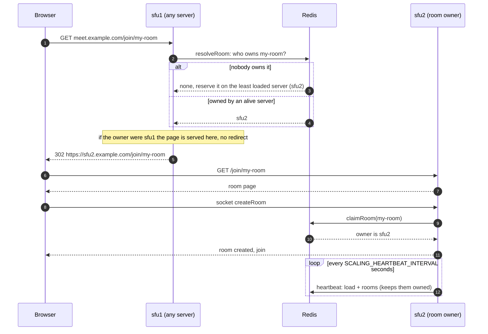

# Horizontal Scaling Module

Two optional switches, both **off by default**. When off, nothing changes: every call is a no-op.

| Switch                            | What it does                                        | Needs |
| --------------------------------- | --------------------------------------------------- | ----- |
| `SCALING_MULTI_WORKER_ROOMS=true` | **Phase 1** - one room can use several CPU cores    | -     |
| `SCALING_CLUSTER=true`            | **Phase 2** - many servers, each room on one server | Redis |

MiroTalk setup guide: [docs/scalability.md](../../../docs/scalability.md) · Tests: `tests/test-Scaling.js`, `tests/test-ScalingPortability.js`

---

## Phase 1 flow - one room, several workers

```text
                         Room "webinar"
┌──────────────────────────┐          ┌──────────────────────────┐
│ Worker 1 · main router   │          │ Worker 2 · extra router  │
│                          │   pipe   │                          │
│  peer A ── video ────────┼─────────►┼──► copy ──► peer B       │
│                          │          │                          │
│  peers 1-20              │          │  peers 21-40             │
│  active speaker, WHIP    │          │  closed when empty       │
└──────────────────────────┘          └──────────────────────────┘
```

1. **Peer joins** → `Room.createWebRtcTransport()` → `routerPool.assignPeer()`: the main router until it has
   `SCALING_MAX_PEERS_PER_ROUTER` peers, then a new router on the least loaded unused worker.
2. **B consumes A on another router** → `Room.consume()` → `routerPool.pipeProducer()` copies A's producer once
   (cached, same id: clients see no difference). Data channels (chat, files) work the same way.
3. **Audio for active speaker** is piped to the main router, where the observers and WHIP ingest live.
4. **Last peer of an extra router leaves** → that router is closed.

## Phase 2 flow - many servers, one room per server



If another server took the room before `claimRoom`, `createRoom` answers `{ redirect }` and the client reloads there.
The diagram renders on GitHub; in VS Code it needs a Mermaid preview extension.

Running in the background on every server:

- **Heartbeat** (every `SCALING_HEARTBEAT_INTERVAL` s): writes its load + rooms to Redis, keeps its rooms owned, releases closed ones.
- **Dead server**: no heartbeat for `SCALING_NODE_TTL` s ⇒ its rooms can be placed on another server.
- **Shutdown** (`SIGTERM`): leaves the cluster first, so new rooms go elsewhere.
- **Redis down**: every request is served locally (standalone mode).

Also cluster-wide: REST `/stats`, `/meetings`, `/activeRooms` (merged), `DELETE /meeting` (forwarded to the owner),
host-protection logins (shared), breakout rooms (always on the main room's server).

---

## Use it in any mediasoup project

The module has **no dependency on MiroTalk** (checked by `tests/test-ScalingPortability.js`): only Node built-ins,
`ioredis` (cluster only) and your mediasoup workers. App-specific rules are passed as callbacks.

```js
const { createScaling } = require('./scaling');

const scaling = createScaling(
    {
        multiWorkerRooms: { enabled: true, maxPeersPerRouter: 20 },
        cluster: { enabled: true, redisUrl: 'redis://10.0.0.10:6379', nodeUrl: 'https://sfu1.example.com' },
    },
    { log: console } // optional
);
scaling.setWorkers(workers); // your mediasoup workers

// Phase 1 - in your room code
const worker = scaling.pickWorker() || roundRobinWorker();
const router = await worker.createRouter({ mediaCodecs });
const pool = scaling.createRoomRouterPool(roomId, mediaCodecs); // null when disabled
pool?.setMainRouter(router, worker);
const peerRouter = pool ? await pool.assignPeer(peerId) : router; // 1. before creating the peer transports
await pool?.pipeProducer(producerId, producerRouter, peerRouter); // 2. before transport.consume()
pool?.releasePeer(peerId); // 3. when the peer leaves
pool?.close(); // 4. when the room closes

// Phase 2 - at startup / on room entry points
await scaling.start({
    getLocalRooms: () => rooms, // Map roomId -> room (peers via room.getPeersCount() or room.peers.size)
    describeRoom: (room) => ({ peers: room.peers.size }), // optional, extra fields go to the snapshot
    getPlacementRoomId: (roomId) => roomId.split('/')[0], // optional, keeps sub-rooms with their parent
    rpcHandlers: { endMeeting: async ({ room }) => endMeeting(room) }, // optional
});
app.use(scaling.createRoutingMiddleware({ getRoomId: (req) => req.params?.roomId || null })); // Express
const url = await scaling.getRedirectUrl(roomId, req.url); // any other HTTP stack (null = serve here)
const { local, url: ownerUrl } = await scaling.claimRoom(roomId); // right before creating the room
await scaling.stop(); // on shutdown
```

More helpers: `getRemoteRooms()`, `isRoomActive()`, `requestAll(type)`, `requestRoomOwner(roomId, type)`,
`getRoomNodeUrl()`, `createSharedSet(name, { onAdd, onRemove })` (a set replicated to every node, e.g. logged-in hosts).

## Files

| File                | Phase | Role                                                          |
| ------------------- | ----- | ------------------------------------------------------------- |
| `index.js`          | both  | Entry point (`createScaling`), no-op when disabled            |
| `WorkerLoad.js`     | 1     | Counts peers per worker, picks the least loaded               |
| `RoomRouterPool.js` | 1     | Routers of one room + producer piping                         |
| `ClusterNode.js`    | 2     | Heartbeat, room placement, RPC and shared sets                |
| `RedisStore.js`     | 2     | Redis access (loaded only when the cluster is on)             |
| `MemoryStore.js`    | 2     | In-memory Redis replacement for tests                         |
| `package.json`      | -     | Package metadata (peer deps: `mediasoup`, optional `ioredis`) |

## How MiroTalk SFU uses it

MiroTalk rules live outside the module in `app/src/ScalingAdapter.js`: the routed entry points (`/join`, `/whoAreYou`,
WHIP), breakout rooms grouped with their main room, the room description and host-protection logins (shared set).

| File                      | Call                                                                                                  |
| ------------------------- | ----------------------------------------------------------------------------------------------------- |
| `Server.js` startup       | `createScaling()`, `setWorkers()`, `startScaling()` (+ adapter callbacks, `shareHostLogins()`)        |
| `Server.js` HTTP          | `createRoutingMiddleware({ getRoomId: getRoutedRoomId })`                                             |
| `Server.js` `createRoom`  | `claimRoom()` + `createRoomRouterPool()` → `new Room(..., { routerPool })`                            |
| `Server.js` REST API      | `getRemoteRooms()`, `requestAll()`, `requestRoomOwner()`, `getRoomNodeUrl()`, `isRoomActive()`        |
| `Server.js` shutdown      | `scaling.stop()`                                                                                      |
| `Room.js`                 | `assignPeerRouter()`, `ensureProducerOnRouter()`, `releasePeer` (fall back to `this.router` when off) |
| `public/js/RoomClient.js` | `createRoom()` follows `{ redirect }`                                                                 |

Note: tests that run `Server.js` handlers in a `vm` sandbox (e.g. `test-CreateRoomAuthorization.js`) must inject
`scaling: createScaling()` and `config`.

## Redis keys

`<prefix>` = `cluster.keyPrefix` (module default `mediasoup-scaling`, MiroTalk uses `mirotalksfu`).

| Key                   | Value                                    |
| --------------------- | ---------------------------------------- |
| `<prefix>:nodes`      | List of server ids                       |
| `<prefix>:node:<id>`  | Server load + rooms (expires if it dies) |
| `<prefix>:room:<id>`  | Id of the server hosting the room        |
| `<prefix>:set:<name>` | Shared sets (MiroTalk: `hostauth`)       |
| `<prefix>:rpc:*`      | Messages between servers (pub/sub)       |

Owner changes are atomic (Lua), so use a single Redis endpoint (Redis Cluster mode is not supported).

## Not implemented: Phase 3 (one room across several servers)

Would need: cross-server `PipeTransport`, shared room state (peers, presenters, chat, polls, locks...),
`@socket.io/redis-adapter` for broadcasts, and owner failover. It touches most socket handlers in `Server.js`.
Easiest first step: webinar cascading (presenters on one server, view-only audience on others).
