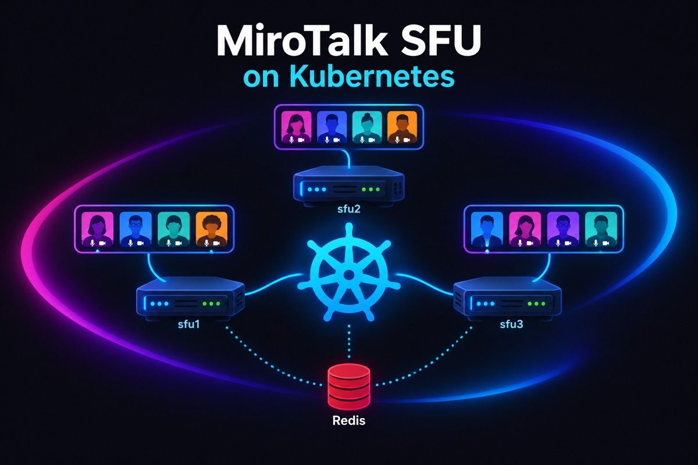

# MiroTalk SFU on Kubernetes (k3s, bare metal / VDS)

<p align="center">
    
</p>

Run MiroTalk SFU on one or more bare-metal / VDS servers with [k3s](https://k3s.io), using the
**WebRTC server mode** (`SFU_SERVER=true`) so every server needs only a handful of media ports, and the built-in
**cluster mode** (`SCALING_CLUSTER=true`) so rooms are spread over the servers.

```text
                         DNS
  meet.example.com  ─►  A records of every SFU node   (shared entry point)
  sfu1.example.com  ─►  sfu1 public IP                 (one host per node)
  sfu2.example.com  ─►  sfu2 public IP

  ┌────────────────────── node sfu1 (VDS) ───────────────────────┐   ┌──── node sfu2 ────┐
  │  Traefik (DaemonSet, host ports 80/443, TLS)                 │   │  same as sfu1     │
  │      │ only to the pod on THIS node                          │   │                   │
  │      ▼                                                       │   │                   │
  │  mirotalksfu (DaemonSet, hostNetwork)                        │   │                   │
  │      :3010             http + websocket (internal only)      │   │                   │
  │      :40000-40004      WebRTC media udp+tcp (public)         │   │                   │
  └──────────────────────────────┬───────────────────────────────┘   └─────────┬─────────┘
                                 └──────────── Redis / Valkey (private) ───────┘
                                          room owners, node load, heartbeats
```

## How it works

1. **One MiroTalk pod per server.** `mirotalksfu` is a DaemonSet on the host network, scheduled only on nodes labelled
   `mirotalk/sfu=true`. Media goes straight from the browser to the server public IP, no load balancer in the media path.
2. **Few ports.** With `SFU_SERVER=true` each mediasoup worker opens one UDP and one TCP port from
   `SFU_MIN_PORT`..`SFU_MIN_PORT + SFU_NUM_WORKERS` (4 workers ⇒ `40000-40004`), instead of a 100+ port range.
3. **Per-node settings without scripts.** Kubernetes fills in the node values at start:
   `SFU_ANNOUNCED_IP=$(NODE_IP)`, `SCALING_NODE_ID=$(NODE_NAME)`, `SCALING_NODE_URL=https://$(NODE_NAME).$(NODE_DOMAIN)`.
   That is why **the DNS host of a node must equal its Kubernetes node name** (`sfu1` ⇒ `sfu1.example.com`).
4. **Traffic stays on its node.** Traefik runs on every node on ports 80/443. The `mirotalksfu` Service uses
   `internalTrafficPolicy: Local` + Traefik `nativelb`, so a request that enters node `sfu2` is always served by the
   MiroTalk pod on `sfu2`.
5. **Rooms are placed by the cluster.** A user opens `https://meet.example.com/join/my-room` and lands on any node. That
   node asks Redis who owns `my-room` (or reserves it on the least loaded node) and either serves the page or redirects
   to `https://sfuN.example.com/join/my-room`. All peers of a room end up on the same node.
6. **Safe restarts.** The DaemonSet uses `updateStrategy: OnDelete`: applying a new config never kills live meetings,
   you restart each node yourself when it is quiet. On `SIGTERM` the pod leaves the cluster first (new rooms go to the
   other nodes), tells clients to reconnect and closes its rooms.

More about cluster mode: [app/src/scaling/README.md](../app/src/scaling/README.md).

## Files

| File                                                                               | What                                                                                            |
| ---------------------------------------------------------------------------------- | ----------------------------------------------------------------------------------------------- |
| [production/kustomization.yaml](production/kustomization.yaml)                     | Entry point (`kubectl apply -k kubernetes/production`). **Cluster-wide settings** (domain...)   |
| [production/mirotalksfu.yaml](production/mirotalksfu.yaml)                         | MiroTalk DaemonSet (host network, per-node env) + node-local Service                            |
| [production/ingress.yaml](production/ingress.yaml)                                 | Hosts and TLS. **One host per node** + the shared `meet` host                                   |
| [production/redis.yaml](production/redis.yaml)                                     | Private Valkey (Redis) used by cluster mode                                                     |
| [production/namespace.yaml](production/namespace.yaml)                             | `mirotalk` namespace                                                                            |
| `production/.env` (you create it, git-ignored)                                     | Your regular MiroTalk `.env`, mounted read-only at `/src/.env`                                  |
| [cluster/traefik-config.yaml](cluster/traefik-config.yaml)                         | Makes the k3s Traefik a DaemonSet on host ports 80/443                                          |
| [cluster/cluster-issuer.yaml](cluster/cluster-issuer.yaml)                         | Let's Encrypt issuer for cert-manager                                                           |
| [local/run.sh](local/run.sh), [local/kustomization.yaml](local/kustomization.yaml) | [Test locally](#test-locally): one-node k3s in Docker, `production` manifests + local overrides |

## Test locally

Try the exact same manifests on your machine before renting servers: a one-node k3s cluster (node `sfu1`) runs inside
Docker, with Traefik, Redis, cluster mode and the WebRTC server, like production.

Requirements: Docker (Docker Desktop on macOS/Windows) and `kubectl`. Free local ports `8443`, `16443`, `40000-40002`.

```bash
./kubernetes/local/run.sh up       # ~2 min the first time (downloads k3s + images)
```

Open **https://meet.localhost:8443** in Chrome or Firefox (accept the self-signed certificate), join a room from two
tabs or browsers and you should see and hear both.

```bash
./kubernetes/local/run.sh status   # pods + URLs
./kubernetes/local/run.sh logs     # follow MiroTalk logs
./kubernetes/local/run.sh down     # delete everything
export KUBECONFIG=$PWD/kubernetes/local/kubeconfig.yaml && kubectl -n mirotalk get pods   # use kubectl directly
```

What differs from production ([local/kustomization.yaml](local/kustomization.yaml)): hosts are `*.localhost:8443` with
Traefik's self-signed certificate, the announced IP is `127.0.0.1` (Docker publishes the media ports there), 2 workers.
If `production/.env` doesn't exist yet, `run.sh` creates it from `.env.template` with a random `JWT_SECRET`.
Only one node runs locally: cluster redirects between nodes need real servers (or one DNS name per node).

## Requirements

- 1+ Linux VDS / bare-metal servers with a **public IPv4 on the network interface** (no NAT), 4+ vCPU each.
- A domain where you can create A records.
- `kubectl` on your machine (kustomize is built in).

> Only one server? Kubernetes is optional: the [Docker Compose](../docker-compose.template.yml) setup with
> `network_mode: host` and `SCALING_MULTI_WORKER_ROOMS=true` gives the same performance with less to operate.

## Setup

### 1. DNS

For every SFU node `sfuN` with public IP `IP_N`:

| Record             | Type | Value                    |
| ------------------ | ---- | ------------------------ |
| `sfu1.example.com` | A    | `IP_1`                   |
| `sfu2.example.com` | A    | `IP_2`                   |
| `meet.example.com` | A    | `IP_1`, `IP_2` (all SFU) |

### 2. Hostnames

On every server, before installing k3s (the hostname becomes the node name):

```bash
hostnamectl set-hostname sfu1   # sfu2, sfu3, ...
```

### 3. Firewall (every node)

```bash
ufw default deny incoming
ufw default allow outgoing
ufw allow 22/tcp
ufw allow 80,443/tcp                       # Traefik (HTTP, HTTPS, Let's Encrypt)
ufw allow 40000:40004/udp                  # WebRTC media: SFU_MIN_PORT..SFU_MIN_PORT+SFU_NUM_WORKERS
ufw allow 40000:40004/tcp                  # WebRTC media over TCP (restrictive networks)
# k3s, only from the OTHER nodes (repeat per node IP)
ufw allow from <OTHER_NODE_IP> to any port 6443,10250 proto tcp
ufw allow from <OTHER_NODE_IP> to any port 51820 proto udp
# k3s pod and service networks
ufw allow from 10.42.0.0/16
ufw allow from 10.43.0.0/16
ufw enable
```

Do **not** open `3010` (MiroTalk, reached only through Traefik) or `6379` (Redis).

### 4. Install k3s

First node (`sfu1`), the control plane. `wireguard-native` encrypts the traffic between nodes over the internet:

```bash
mkdir -p /var/lib/rancher/k3s/server/manifests
cp kubernetes/cluster/traefik-config.yaml /var/lib/rancher/k3s/server/manifests/   # Traefik on every node
curl -sfL https://get.k3s.io | sh -s - server --flannel-backend=wireguard-native
cat /var/lib/rancher/k3s/server/node-token   # join token for the other nodes
cat /etc/rancher/k3s/k3s.yaml                # kubeconfig: copy it to your machine, replace 127.0.0.1 with IP_1
```

Other nodes:

```bash
curl -sfL https://get.k3s.io | K3S_URL=https://<IP_1>:6443 K3S_TOKEN=<node-token> sh -
```

Check: `kubectl get nodes -o wide`. The `INTERNAL-IP` column must show the **public** IPs (see
[Troubleshooting](#troubleshooting) if not), and `kubectl -n kube-system get ds traefik` must show one Traefik pod per node.

### 5. TLS (cert-manager + Let's Encrypt)

```bash
kubectl apply -f https://github.com/cert-manager/cert-manager/releases/latest/download/cert-manager.yaml
kubectl -n cert-manager rollout status deploy/cert-manager-webhook
# set your email in cluster/cluster-issuer.yaml, then:
kubectl apply -f kubernetes/cluster/cluster-issuer.yaml
```

### 6. Configure MiroTalk

```bash
cd kubernetes/production
cp ../../.env.template .env
```

- **`.env`**: your usual MiroTalk settings. It is shared by every node, so secrets are identical everywhere.
  **`JWT_SECRET` is required** (`openssl rand -hex 32`), the server won't start without it. Also set `API_KEY_SECRET`,
  `HOST_*`, `OIDC_*`, ... as you need.
- **[kustomization.yaml](production/kustomization.yaml)**: `NODE_DOMAIN`, `SERVER_HOST_URL`, `SFU_NUM_WORKERS` (≤ vCPUs per node).
  These, and the per-node values in [mirotalksfu.yaml](production/mirotalksfu.yaml), **override the same keys in `.env`**.
- **[ingress.yaml](production/ingress.yaml)**: your hosts, one per node + `meet`, in both `tls.hosts` and `rules`.

### 7. Deploy

```bash
kubectl label node sfu1 sfu2 mirotalk/sfu=true
kubectl apply -k .
kubectl -n mirotalk get pods -o wide -w   # one mirotalksfu pod per node + redis, all Running 1/1
```

(`kubectl rollout status` does not work with `OnDelete` DaemonSets, watch the pods instead.)

### 8. Verify

```bash
kubectl -n mirotalk logs -l app=mirotalksfu --tail=-1 | grep -E "Create a WebRtcServer|Cluster mode active"
kubectl -n mirotalk get certificate                     # READY True
curl -sI https://sfu1.example.com | head -1             # 200
curl -sI https://meet.example.com/join/test | head -3   # 200, or 302 to https://sfuN.example.com/join/test
```

Then join one room from two different networks (e.g. mobile data + home Wi-Fi) and check audio/video.

## Operations

| Task                       | How                                                                                                                                                                                                                                                                                                           |
| -------------------------- | ------------------------------------------------------------------------------------------------------------------------------------------------------------------------------------------------------------------------------------------------------------------------------------------------------------- |
| **Add a node**             | Hostname, firewall, join k3s (steps 2-4), add DNS `sfuN` + add its IP to `meet`, add the host to [ingress.yaml](production/ingress.yaml), `kubectl apply -k kubernetes/production`, `kubectl label node sfuN mirotalk/sfu=true`                                                                               |
| **Remove a node**          | Remove its IP from the `meet` DNS record, wait until it has no meetings, `kubectl label node sfuN mirotalk/sfu-`                                                                                                                                                                                              |
| **Change config / update** | Edit, `kubectl apply -k kubernetes/production`, then restart one node at a time when quiet: `kubectl -n mirotalk delete pod -l app=mirotalksfu --field-selector spec.nodeName=sfu1`. Pin `image:` to a version tag in production                                                                              |
| **More workers**           | Raise `SFU_NUM_WORKERS` and open the new port range in the firewall on every node                                                                                                                                                                                                                             |
| **Recording**              | `RECORDING_ENABLED=true` in `.env`, uncomment the `rec` volume in [mirotalksfu.yaml](production/mirotalksfu.yaml). Files stay on the node that hosted the room, in `/var/lib/mirotalksfu/rec` (must be writable by uid 1000: `mkdir -p /var/lib/mirotalksfu/rec && chown 1000:1000 /var/lib/mirotalksfu/rec`) |
| **Own `config.js`**        | Copy `app/src/config.template.js` to `kubernetes/production/config.js`, uncomment the `mirotalksfu-config` generator in [kustomization.yaml](production/kustomization.yaml) and the `config` volume in [mirotalksfu.yaml](production/mirotalksfu.yaml)                                                        |
| **Logs**                   | `kubectl -n mirotalk logs -f -l app=mirotalksfu --max-log-requests=10`                                                                                                                                                                                                                                        |

A stopping pod finishes within ~30 seconds (`terminationGracePeriodSeconds: 45`); its users get a "server restarting"
notice and reconnect.

## Troubleshooting

| Symptom                                             | Fix                                                                                                                                                                                                                                |
| --------------------------------------------------- | ---------------------------------------------------------------------------------------------------------------------------------------------------------------------------------------------------------------------------------- |
| Pod `CrashLoopBackOff`, log `JWT_SECRET is not set` | Set `JWT_SECRET` in `.env`, `kubectl apply -k kubernetes/production`, delete the pods                                                                                                                                              |
| No pod on a node                                    | Node not labelled: `kubectl label node sfuN mirotalk/sfu=true`                                                                                                                                                                     |
| Pod `CrashLoopBackOff`, log `EADDRINUSE`            | Port `3010` / `40000+` already used on the host, e.g. an old Docker Compose MiroTalk still running                                                                                                                                 |
| Page loads, but no audio/video                      | Media ports blocked (firewall / provider firewall, UDP **and** TCP), or wrong announced IP: `kubectl -n mirotalk exec <pod> -- printenv SFU_ANNOUNCED_IP` must be the public IP                                                    |
| `INTERNAL-IP` is a private IP                       | k3s picked a private interface. Reinstall with `--node-ip=<public ip>`, or delete the `SFU_ANNOUNCED_IP` entry in [mirotalksfu.yaml](production/mirotalksfu.yaml) so MiroTalk detects its public IP itself (`NODE_ENV=production`) |
| Redirect loops / room on the wrong server           | DNS `sfuN.example.com` must point to node `sfuN`, and the node name must equal `sfuN` (`kubectl get nodes`)                                                                                                                        |
| Traefik `404 page not found`                        | The host is missing in [ingress.yaml](production/ingress.yaml)                                                                                                                                                                     |
| Requests to one node hang, then `502`/`504`         | No MiroTalk pod on that node (traffic never leaves its node): `meet` DNS must list **only** SFU nodes, check the pod on that node                                                                                                  |
| Certificate not `READY`                             | Port 80 open, all hosts resolve to the right nodes: `kubectl describe certificate -n mirotalk mirotalksfu-tls`                                                                                                                     |

## Notes

- **Redis** holds only short-lived cluster state, so a single instance is enough. If it is down, every node keeps serving
  its own rooms. It is reachable only inside the cluster; add `--requirepass` and `redis://:pass@...` if other workloads
  share the cluster.
- **Restrictive networks**: MiroTalk SFU does not use TURN. Media uses UDP, with a fallback to TCP on the same
  ports (`40000-40004`), so open both protocols. Networks that allow only port 443 can't reach the media ports.
- **CPU**: the pod has no CPU limit on purpose (throttling causes media glitches). Don't run other heavy workloads on the
  SFU nodes.
