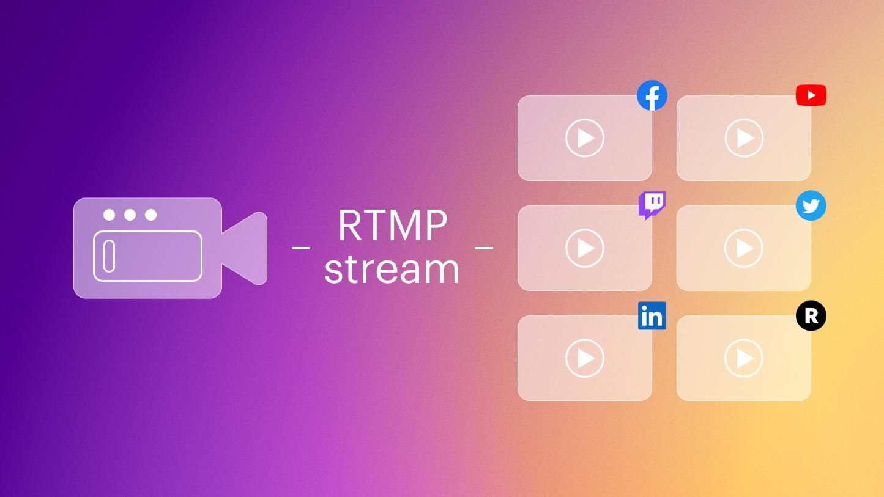

# RTMP Streaming



For running an `RTMP` (Real-Time Messaging Protocol) server in Node, **[Node-Media-Server](https://github.com/illuspas/Node-Media-Server)** is one of the best options.

## Quick Start

```sh
# Create the config file for the server
$ cp config.template.js config.js
# Install the dependencies
$ npm install
# Start the RTMP Server
$ npm start
```

## Using Docker

```sh
# Create the config file for the server
$ cp config.template.js config.js

# Copy the docker.compose.yml
$ cp docker-compose.template.yml docker-compose.yml

# Pull the official mirotalk rtmp image
$ docker pull mirotalk/nms:latest

# Create and start containers
$ docker-compose up -d

# Check the logs
$ docker logs -f mirotalk-nms

# To stop and remove resources
$ docker-compose down
```

## Build and Push the Docker Image

```sh
# Reset config.js to defaults so local settings are not baked into the image
$ cp src/config.template.js src/config.js

# Build the image locally (current platform only)
$ docker build -t mirotalk/nms:latest .

# Multi-platform build requires a docker-container builder (one-time setup)
$ docker buildx create --name multiarch --driver docker-container --use
$ docker buildx inspect --bootstrap

# Log in to your registry
$ docker login

# Build for amd64 and arm64 and push (replace mirotalk/nms with your own repository)
$ docker buildx build --platform linux/amd64,linux/arm64 -t mirotalk/nms:latest --file Dockerfile . --push
```

> **Note:** Everything in `src/` (including `cert.pem` and `key.pem`) is copied into the image. Mount real certificates at runtime via `docker-compose.yml` instead of baking them in.

## Dashboard & API

[http://localhost:8081/admin](http://localhost:8081/admin)
[http://localhost:8081/api/server](http://localhost:8081/api/server)

## Custom Configuration

Modify the `config.js` to suit your specific needs.
